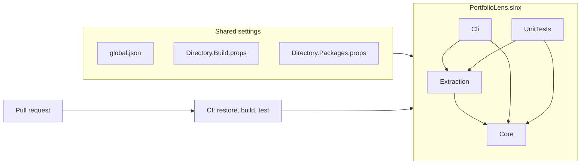

# Phase 0 — Setup

## The problem

A new repo has no rules. Each project can pick its own package versions. Each machine can use a different SDK. Nothing checks the code after a push.

Rules that arrive late are expensive. If you turn on "warnings are errors" after 3 months, you get hundreds of errors on one day. If you add CI after 3 months, you learn that the build worked only on one laptop.

## Real world

In March 2016, the author of `left-pad` removed the package from npm. It had 11 lines of code. Builds of Babel, React, and many other projects broke, and those teams had changed nothing. A build depends on things that you do not control. So you pin them, and you check them on each push.

## What was built

- One solution (`PortfolioLens.slnx`) with 4 projects: `Core`, `Extraction`, `Cli`, `UnitTests`.
- `global.json` pins the SDK and selects the test runner.
- `Directory.Build.props` gives the same compiler rules to each project: nullable on, warnings are errors, analyzers on.
- `Directory.Packages.props` holds each package version in one place.
- A GitHub Actions workflow that runs restore, build, and test on each pull request.
- 2 small fake projects in `fixtures/`: one SDK-style, one old-style with `packages.config`. Tests in the next phase read them.
- 3 decision records in `docs/adr/`.

## Why this way

Strict rules cost nothing on empty projects. The same rules cost days on a full code base. So the rules came first and the code comes second.

`Core` references no other project. All other projects point to `Core`. The compiler now stops a wrong reference, so the rule does not depend on memory.

There is one exception to "warnings are errors". NuGet security warnings (NU1901–NU1904) stay warnings. A new advisory can appear on any day, and it must not block an unrelated fix. ADR 0002 has the details.

## What was hard

Not much, and that is the point of this phase. The numbers at the end:

- Build: 0 warnings, 0 errors.
- Tests: 1 of 1 green. The test only proves that the test runner works.
- CI: green on the pull request. The build-and-test job took 27 seconds.

One trap is worth a note. xUnit v3 on .NET 10 runs on Microsoft Testing Platform. `dotnet test` needs a `test` block in `global.json` to use it. Without the block, `dotnet test` uses the old VSTest mode and the tests do not run correctly.
