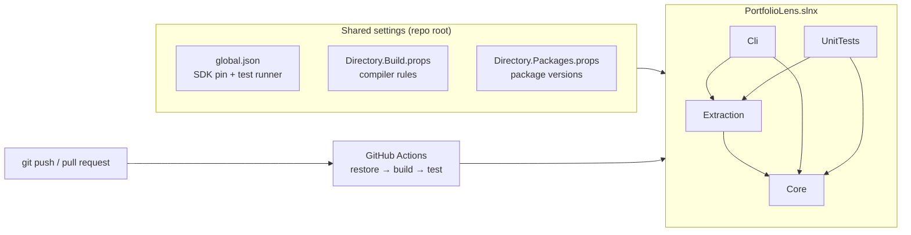

# Phase 0 — Setup

**Goal:** an empty solution that builds, tests, and runs in CI. Test input is on disk.

**Time:** half an evening.

**Extended:** 2026-11-10. I ran each command and each file below in a temp folder with SDK 10.0.403. Result: build 0 warnings, 0 errors; 1 test green. I did **not** run the CI workflow (step 9) and the `gh` commands (steps 2, 9, 13).

## The story

- **Where we are:** The repo has one commit. It has a `.gitignore` for Node. There is no code.
- **What still hurts:** Nothing checks the code. Each project can pick its own package versions. Each machine can use a different SDK.
- **The problem:** Without a base, rules arrive late. You add "warnings are errors" in month 3 and you get 400 errors. You add CI in month 3 and you find that the build worked only on your Mac.
- **Real world 1 — left-pad, March 2016:** The author removed an 11-line package from npm. Builds of Babel and React broke for many teams, with no change in their own code. The lesson: your build depends on things you do not control. Pin them and check them on each push.
- **Real world 2 — NuGet audit:** Since SDK 8.0.100, `dotnet restore` reports packages with known security holes (warnings NU1901–NU1904). For `net10.0` projects it checks indirect packages too. If warnings are errors, a new advisory breaks your build with no code change. Microsoft's NuGet documentation describes this and tells you how to prevent it. We do that in step 4.
- **What we build:** One solution, 4 empty projects, 3 shared settings files, one CI workflow, 2 fake projects for tests, and 6 cloned repos to scan.
- **Why this way:** Strict rules cost nothing on empty projects. The same rules cost days on a full code base. We did not choose "code first, rules later".
- **What we did not choose:** MSBuild `.sln` (old format), xUnit v2 (old line), VSTest (old test runner). Reasons are in the decisions below.

## Decisions for this phase (owner, 2026-11-10)

| Topic | Decision | Why |
|---|---|---|
| Solution file | `.slnx` | It is the .NET 10 default. It is short XML. The scanner must read it in Phase 1 |
| Test framework | xUnit v3 (`xunit.v3` 4.0.3) | Most used in open-source .NET. Good with Testcontainers and Verify |
| Test runner | Microsoft Testing Platform (MTP) | It is the default of the xUnit v3 template for `net10.0`. The test project is a normal `.exe` |
| Analyzers | `AnalysisLevel=latest-recommended` + `EnforceCodeStyleInBuild=true` | CI finds style problems, not only the editor |
| `CLAUDE.md` | Commit it | It shows the rules behind `docs/ai-log.md` |
| Repo visibility | Public at the end of Phase 0 | First CI green and `me/private/` not in git |
| Git flow | One branch + one pull request per phase | CI checks before the merge. The review reads one diff |

## What the phase builds



`fixtures/` and `scan-input/` are **not** in the solution. They are input data, not code to build.

## Steps

### 1. Make the branch

Why: all Phase 0 work goes into one pull request.

```bash
git switch -c phase-0-setup
```

`.gitignore` has one change that is not committed. It moves to the new branch with you. That is OK.

### 2. Replace `.gitignore`

Why: the current file is for Node. It does not ignore `bin/` and `obj/`.

```bash
dotnet new gitignore --force
```

Then add these lines at the end, by hand:

```gitignore
# PortfolioLens
me/private/
scan-input/
scan-output/
```

- **Trap:** without `--force` the command fails (exit code 73), because the file exists.
- **Trap:** `--force` deletes your old lines. The line `me/private/` is gone until you add it again. Run `git status` after this step. `me/private/` must not be in the list.
- The template already has `.env`, `.DS_Store`, `bin/`, `obj/`, `.vs/`, `.idea/`. Do not add them again.
- Do not add the `CLAUDE.md` line again. You decided to commit that file.
- **Before you commit `CLAUDE.md`:** read it one time as a stranger. Change or remove what a stranger must not see.

### 3. Pin the SDK: `global.json`

Why: all machines and CI use the same SDK line. A new SDK can change warnings.

```bash
dotnet new globaljson --sdk-version 10.0.403 --roll-forward latestFeature
```

Then add the `test` block by hand. The full file:

```json
{
  "sdk": {
    "version": "10.0.403",
    "rollForward": "latestFeature"
  },
  "test": {
    "runner": "Microsoft.Testing.Platform"
  }
}
```

- `latestFeature` = "use 10.0.403 or a newer 10.0.x SDK". It never jumps to .NET 11.
- The `test` block tells `dotnet test` to use MTP. On .NET 10 SDK, xUnit v3 needs this block. Source: the xUnit v3 template (4.0.3) adds it.
- **Trap:** without the `test` block, `dotnet test` uses the old VSTest mode and does not run the tests correctly.

### 4. Compiler rules: `Directory.Build.props`

Why: one file gives the same rules to each project. MSBuild reads it automatically for each project below this folder.

```bash
dotnet new buildprops
```

Content:

```xml
<Project>
  <PropertyGroup>
    <TargetFramework>net10.0</TargetFramework>
    <LangVersion>latest</LangVersion>
    <Nullable>enable</Nullable>
    <ImplicitUsings>enable</ImplicitUsings>
    <TreatWarningsAsErrors>true</TreatWarningsAsErrors>
    <AnalysisLevel>latest-recommended</AnalysisLevel>
    <EnforceCodeStyleInBuild>true</EnforceCodeStyleInBuild>
    <WarningsNotAsErrors>$(WarningsNotAsErrors);NU1901;NU1902;NU1903;NU1904</WarningsNotAsErrors>
  </PropertyGroup>
</Project>
```

Reason for each line:

| Line | Reason |
|---|---|
| `TargetFramework` | One place to move all projects to .NET 11 later |
| `Nullable` | The compiler finds possible `null` errors |
| `TreatWarningsAsErrors` | A warning that nobody must fix is a warning that nobody reads |
| `AnalysisLevel` | Turns on the recommended set of .NET analyzer rules (CAxxxx) |
| `EnforceCodeStyleInBuild` | Style rules (IDExxxx) from `.editorconfig` run in the build, so in CI too |
| `WarningsNotAsErrors` | NuGet security warnings stay warnings. A new advisory must not block an unrelated fix. This is the story of "Real world 2" |

- **Trap:** `TreatWarningsAsErrors` hurts at first. Keep it. It is easier now than later.
- The `WarningsNotAsErrors` choice needs a "why". Write it as ADR 0002 in step 10.

### 5. Package versions: `Directory.Packages.props`

Why: Central Package Management (CPM). All versions are in one file. Two projects can never use two versions of one package.

```bash
dotnet new packagesprops
```

Content:

```xml
<Project>
  <PropertyGroup>
    <ManagePackageVersionsCentrally>true</ManagePackageVersionsCentrally>
  </PropertyGroup>
  <ItemGroup>
    <PackageVersion Include="xunit.v3" Version="4.0.3" />
  </ItemGroup>
</Project>
```

- With CPM, a `.csproj` has `<PackageReference Include="xunit.v3" />` with **no** `Version`.
- **Trap:** a `Version` in a `.csproj` gives error NU1008.
- Version checked on nuget.org, 2026-11-10: `xunit.v3` 4.0.3 is the latest stable.

### 6. Solution and projects

Why: the smallest set that Phase 1 needs. Other projects come with their phase.

```bash
dotnet new sln -n PortfolioLens

dotnet new classlib -n PortfolioLens.Core       -o src/PortfolioLens.Core
dotnet new classlib -n PortfolioLens.Extraction -o src/PortfolioLens.Extraction
dotnet new console  -n PortfolioLens.Cli        -o src/PortfolioLens.Cli

dotnet sln add src/PortfolioLens.Core src/PortfolioLens.Extraction src/PortfolioLens.Cli

dotnet add src/PortfolioLens.Extraction reference src/PortfolioLens.Core
dotnet add src/PortfolioLens.Cli        reference src/PortfolioLens.Core src/PortfolioLens.Extraction
```

`dotnet new sln` makes `PortfolioLens.slnx`. This is what it looks like after step 7:

```xml
<Solution>
  <Folder Name="/src/">
    <Project Path="src/PortfolioLens.Cli/PortfolioLens.Cli.csproj" />
    <Project Path="src/PortfolioLens.Core/PortfolioLens.Core.csproj" />
    <Project Path="src/PortfolioLens.Extraction/PortfolioLens.Extraction.csproj" />
  </Folder>
  <Folder Name="/tests/">
    <Project Path="tests/PortfolioLens.UnitTests/PortfolioLens.UnitTests.csproj" />
  </Folder>
</Solution>
```

Now clean up by hand:

1. Delete `src/PortfolioLens.Core/Class1.cs` and `src/PortfolioLens.Extraction/Class1.cs`.
2. In each `.csproj`, remove `TargetFramework`, `ImplicitUsings`, and `Nullable`. They come from `Directory.Build.props` now.

A library `.csproj` is then only this, plus its `ProjectReference` lines:

```xml
<Project Sdk="Microsoft.NET.Sdk">
</Project>
```

The Cli keeps `<OutputType>Exe</OutputType>`.

- **Trap:** `Core` must have zero `ProjectReference` and zero `PackageReference`. Check it now. This rule holds for the whole project.
- Look at the `.slnx` file. Remember its shape. Your scanner reads `.sln` **and** `.slnx` in Phase 1.

### 7. Test project (by hand)

Why: the SDK template `dotnet new xunit` makes xUnit **v2** (`xunit` 2.9.3). We want v3. You write the project file by hand, so you see each part.

```bash
mkdir -p tests/PortfolioLens.UnitTests
```

`tests/PortfolioLens.UnitTests/PortfolioLens.UnitTests.csproj`:

```xml
<Project Sdk="Microsoft.NET.Sdk">
  <PropertyGroup>
    <OutputType>Exe</OutputType>
    <IsPackable>false</IsPackable>
    <UseMicrosoftTestingPlatformRunner>true</UseMicrosoftTestingPlatformRunner>
  </PropertyGroup>
  <ItemGroup>
    <PackageReference Include="xunit.v3" />
  </ItemGroup>
  <ItemGroup>
    <Using Include="Xunit" />
  </ItemGroup>
</Project>
```

| Line | Reason |
|---|---|
| `OutputType Exe` | An xUnit v3 test project is a program. You can run it directly |
| `UseMicrosoftTestingPlatformRunner` | The program uses the MTP command line, the same one `dotnet test` talks to |
| `Using Include="Xunit"` | No `using Xunit;` line in each test file |

`tests/PortfolioLens.UnitTests/SmokeTests.cs`:

```csharp
namespace PortfolioLens.UnitTests;

public class SmokeTests
{
    [Fact]
    public void Test_runner_works()
    {
        Assert.Equal(4, 2 + 2);
    }
}
```

```bash
dotnet sln add tests/PortfolioLens.UnitTests
dotnet add tests/PortfolioLens.UnitTests reference src/PortfolioLens.Core src/PortfolioLens.Extraction
```

- **Trap (it will happen):** `dotnet build` fails with `error CA1707: Remove the underscores from member name`. This is the strict analyzer set from step 4. Test names with underscores are a good habit. Step 8 turns this one rule off for tests only.

### 8. `.editorconfig`

Why: one style for each editor and for the build.

```bash
dotnet new editorconfig
```

Add at the end, by hand:

```ini
# Test names use underscores: Method_State_Result
[tests/**.cs]
dotnet_diagnostic.CA1707.severity = none
```

Now check all of it:

```bash
dotnet build
dotnet test
dotnet run --project src/PortfolioLens.Cli
```

Expected: `0 Warning(s) 0 Error(s)`, then `total: 1, succeeded: 1`, then `Hello, World!`.

- This is the pattern for each analyzer rule you do not agree with: turn it off in `.editorconfig`, in the smallest scope, with a comment that says why. Do not use `#pragma` in code and do not remove `TreatWarningsAsErrors`.

### 9. CI

Why: the build must work on a clean machine, not only on your Mac.

`.github/workflows/ci.yml`:

```yaml
name: CI

on:
  push:
    branches: [main]
  pull_request:

permissions:
  contents: read

jobs:
  build-test:
    runs-on: ubuntu-latest
    steps:
      - uses: actions/checkout@v7
      - uses: actions/setup-dotnet@v6
      - run: dotnet restore
      - run: dotnet build --no-restore --configuration Release
      - run: dotnet test --no-build --configuration Release
```

| Line | Reason |
|---|---|
| `push` only on `main` + `pull_request` | A branch push with an open pull request runs CI one time, not two times |
| `permissions: contents: read` | The job can read the repo and nothing more. Least privilege |
| `setup-dotnet` with no version | The action reads `global.json`. One source for the SDK version |
| `--no-restore`, `--no-build` | Each stage runs one time. A failure shows in the correct stage |
| `Release` | CI tests the configuration that you ship |

- Versions checked 2026-11-10: `actions/checkout` latest is v7.0.1, `actions/setup-dotnet` latest is v6.1.0.
- I ran the 3 `dotnet` commands on the Mac. They pass. ⚠ I did not run the workflow on GitHub.
- **Trap:** Linux file names are case-sensitive. The Mac is not. `Directory.build.props` works on the Mac and does nothing in CI.

### 10. ADRs

Why: an ADR (Architecture Decision Record) is a short note: what you decided and why. You write it when the reason is fresh.

`docs/adr/0001-record-decisions.md` — the template:

```markdown
# 0001 — Record decisions as ADRs

Date: 2026-11-10
Status: Accepted

## Context
In 3 months I will not remember why the code is this way.

## Decision
Each decision that someone can ask "why?" about gets one file in `docs/adr/`.
Name: `NNNN-short-title.md`. Length: 5–10 lines. An ADR is never edited later;
a new ADR replaces it and the old one gets `Status: Superseded by NNNN`.

## Consequences
One more small file per decision. The history of "why" stays in the repo.
```

Write these in your own words, same shape:

- `0002-nuget-audit-warnings-not-errors.md` — step 4.
- `0003-slnx-and-xunit-v3-mtp.md` — the two tool choices of this phase.

### 11. Fixtures

Why: tests need small, fixed input. Real repos change.

Make these by hand. They are data. They are not in the solution.

`fixtures/sdk-style-net10/SdkStyle.csproj`:

```xml
<Project Sdk="Microsoft.NET.Sdk">
  <PropertyGroup>
    <TargetFramework>net10.0</TargetFramework>
  </PropertyGroup>
  <ItemGroup>
    <PackageReference Include="Newtonsoft.Json" Version="13.0.3" />
    <PackageReference Include="Serilog" Version="4.4.0" />
  </ItemGroup>
</Project>
```

`fixtures/old-style-net472/OldStyle.csproj`:

```xml
<?xml version="1.0" encoding="utf-8"?>
<Project ToolsVersion="15.0" DefaultTargets="Build" xmlns="http://schemas.microsoft.com/developer/msbuild/2003">
  <PropertyGroup>
    <OutputType>Library</OutputType>
    <RootNamespace>OldStyleNet472</RootNamespace>
    <AssemblyName>OldStyleNet472</AssemblyName>
    <TargetFrameworkVersion>v4.7.2</TargetFrameworkVersion>
  </PropertyGroup>
  <ItemGroup>
    <Reference Include="System" />
    <Reference Include="Newtonsoft.Json, Version=13.0.0.0, Culture=neutral, PublicKeyToken=30ad4fe6b2a6aeed, processorArchitecture=MSIL">
      <HintPath>..\packages\Newtonsoft.Json.13.0.3\lib\net45\Newtonsoft.Json.dll</HintPath>
    </Reference>
  </ItemGroup>
  <ItemGroup>
    <Compile Include="Class1.cs" />
    <None Include="packages.config" />
  </ItemGroup>
  <Import Project="$(MSBuildToolsPath)\Microsoft.CSharp.targets" />
</Project>
```

`fixtures/old-style-net472/packages.config`:

```xml
<?xml version="1.0" encoding="utf-8"?>
<packages>
  <package id="Newtonsoft.Json" version="13.0.3" targetFramework="net472" />
</packages>
```

The 4 differences that your Phase 1 reader must handle. Find each one in the files:

| | SDK-style | Old-style |
|---|---|---|
| Root element | `Sdk="..."` attribute, no namespace | `xmlns` from 2003, no `Sdk` |
| Framework | `TargetFramework` = `net10.0` | `TargetFrameworkVersion` = `v4.7.2` |
| Packages | `PackageReference` in the `.csproj` | `packages.config` + `Reference` with `HintPath` |
| Source files | All `*.cs` automatically | Each file has a `Compile` line |

- **Trap:** the fixture `.csproj` files use `Version=` on `PackageReference`. That is correct. They are data, CPM does not apply to them, because they are not in the solution.
- **Trap:** do not add fixtures with `dotnet sln add`. Do not run `dotnet build` inside `fixtures/`.
- I checked: `dotnet build` at the repo root ignores `fixtures/`. The old-style XML is well-formed.

### 12. Clone scan input

Why: Phase 1 needs real repos on disk. 6 small ones are enough now. The big ones come later.

```bash
mkdir -p scan-input && cd scan-input

git clone --depth 1 https://github.com/NimblePros/eShopOnWeb
git clone --depth 1 https://github.com/jbogard/ContosoUniversityDotNetCore
git clone --depth 1 https://github.com/dotnet/eShop
git clone --depth 1 https://github.com/dotnet-architecture/eShopModernizing
git clone --depth 1 --branch release-3.90   https://github.com/nopSolutions/nopCommerce nopCommerce-3.90
git clone --depth 1 --branch release-4.90.8 https://github.com/nopSolutions/nopCommerce nopCommerce-4.90

cd ..
git status
```

- `git status` must not show `scan-input/`.
- The full list is in `scan-targets.md`. Do not clone `dotnet/roslyn` now.

### 13. Commit, pull request, merge, go public

Why: small commits tell the story. CI must be green before the merge.

One commit for the whole phase (owner's choice, 2026-11-10). From Phase 1 on, each step has its own commit message.

```bash
git add -A
git status
git commit -m "Add solution, shared build settings, CI, ADRs, and fixtures" \
  -m "Strict compiler rules and CI cost nothing on empty projects.
The ADRs record why NuGet audit warnings stay warnings and why the repo uses .slnx and xUnit v3 on MTP.
The fixtures give Phase 1 one SDK-style and one old-style project to read."
```

- **Trap:** read the `git status` output before the commit. It must not show `scan-input/` or `bin/` or `obj/`.

```bash
git push -u origin phase-0-setup
gh pr create --base main --title "Phase 0: setup" --body "Solution, shared build settings, CI, ADRs, first fixtures."
gh pr checks --watch
```

Tell me when CI is green. I review the diff (`git diff main...phase-0-setup`). Then:

**Change of plan (2026-11-10).** The review found private files in an old commit. A deleted file stays in the git history. So the pull request is not merged. The old repo stays private with a new name, and a new repo gets a clean history of one commit.

Why not a rewrite and a force-push: GitHub keeps old commits behind the pull request and by commit ID.

```bash
# 1. Check that the private folder is ignored. Each command must print a rule.
git check-ignore -v me/private/interview-qa.md
git check-ignore -v scan-input

# 2. Give the old repo a new name. It stays private.
gh repo rename PortfolioLens-old --repo BaiGanio/PortfolioLens --yes

# 3. Make a branch with no history, and put all files in one commit.
git checkout --orphan fresh
git add -A
git status
```

- **Trap:** read the `git status` list. It must not show `me/private/`, `scan-input/`, `bin/`, or `obj/`.

```bash
git commit -m "Add solution, shared build settings, CI, ADRs, fixtures, and the plan" \
  -m "Strict compiler rules and CI cost nothing on empty projects.
The ADRs record why NuGet audit warnings stay warnings and why the repo uses .slnx and xUnit v3 on MTP.
The plan and the story are public, so each phase shows the problem before the solution."

# 4. Delete the old local branches. Make the new branch `main`.
git branch -D main phase-0-setup
git branch -m fresh main

# 5. Make the new repo (private for now) and push.
gh repo create BaiGanio/PortfolioLens --private
git remote set-url origin https://github.com/BaiGanio/PortfolioLens.git
git remote -v
git push -u origin main
git fetch --prune

# 6. Wait for CI.
gh run watch
```

Last, the safety check and the switch to public:

```bash
git log --all --name-only --format= | sort -u
```

No line may start with `scan-input/` or `scan-output/`. Each `me/` line must start with `me/plan/`. Then:

```bash
gh repo edit BaiGanio/PortfolioLens --visibility public --accept-visibility-change-consequences
```

- **Trap:** public is hard to undo. What was public can be copied. Do the check first.
- **Trap:** use `git checkout --orphan`, not `git switch --orphan`. The `switch` form deletes the tracked files from the folder.
- ⚠ I did not run the `gh` commands of this step.

## Done when

- [x] `dotnet build` shows 0 warnings and 0 errors.
- [x] `dotnet test` shows `total: 1`, `succeeded: 1`.
- [x] `src/PortfolioLens.Core/PortfolioLens.Core.csproj` has no reference of any type.
- [x] No `.csproj` in `src/` or `tests/` has a `Version=` attribute.
- [x] CI is green on `main` of the new repo.
- [x] `git status` does not show `me/private/` or `scan-input/`.
- [x] `scan-input/` has a minimum of 5 repos.
- [x] `docs/adr/` has 3 ADRs.
- [x] `fixtures/` has 2 folders and is not in `PortfolioLens.slnx`.
- [x] The new repo has a clean history. The repo is public.

## Hints

- Build error that you do not know? Read the code (`CAxxxx`, `IDExxxx`, `NUxxxx`). Search it on learn.microsoft.com. Then decide: fix the code, or turn the rule off in `.editorconfig` with a reason.
- `dotnet build -v n` shows more detail. `dotnet --info` shows which SDK `global.json` selected.
- `dotnet format` fixes style problems automatically. It is not in CI now. We can add it later.

## Say it in the interview

"I set up CI, analyzers, and central package versions before I wrote the first feature."

Second sentence, from this phase: "The strict analyzers failed my first test, on the test name. I turned off that one rule for the test folder only, with a comment, and kept warnings as errors."
