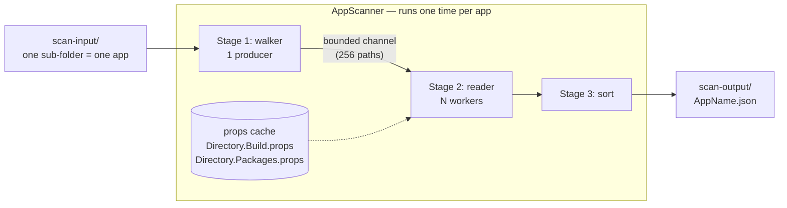
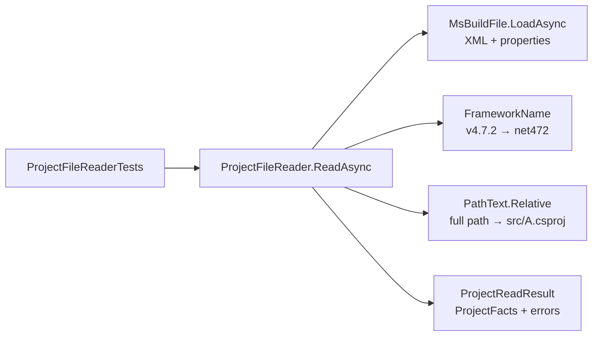
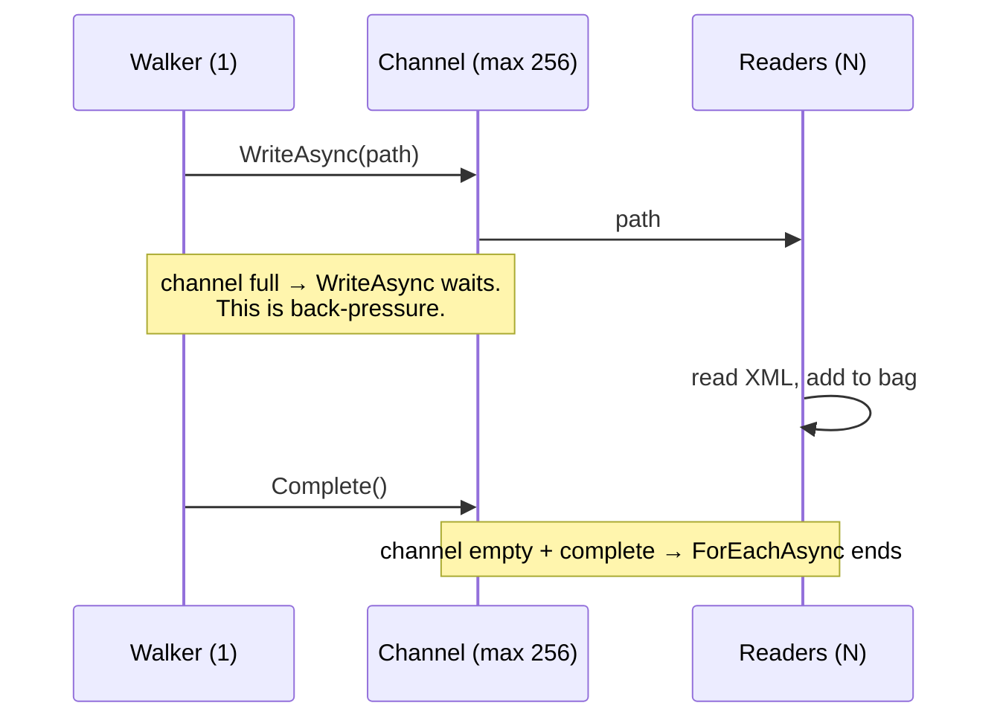

# Phase 1 — Extractor (console app)

**Goal:** point the CLI at a folder of repos. Get one JSON file per app with its projects, frameworks, packages, and references.

**Time:** 3–4 evenings.

**Extended:** 2026-11-10. I wrote a full test copy of this phase in a temp folder, with SDK 10.0.403 and the same `Directory.Build.props`. Result: build 0 warnings, 0 errors; 11 tests green; scan of the 6 repos in `scan-input/` with no crash. Each code block below comes from that copy. I did **not** scan `dotnet/roslyn` (it is not cloned). I did **not** run the `git` and `gh` commands.

## The story

- **Where we are:** Phase 0 gave us an empty solution with strict rules, CI, 2 fixtures, and 6 cloned repos. The CLI prints `Hello, World!`.
- **What still hurts:** We know nothing about the repos. How many projects? Which .NET version? Which packages? You must open each `.csproj` by hand.
- **The problem:** You cannot plan a modernization of things you cannot list. The facts are in hundreds of XML files, in 2 different formats, and part of each fact is in a different file (`packages.config`, `Directory.Packages.props`).
- **Real world 1 — Log4Shell, December 2021:** A critical hole was found in the Java library Log4j. The first question in each company was "which of our apps use it, and which version?". The US Cyber Safety Review Board wrote in its report (July 2022) that many organizations could not answer that quickly, because they had no inventory of their dependencies. Phase 1 builds that inventory for .NET.
- **Real world 2 — .NET Framework 4.6.1, April 2022:** Microsoft ended support for .NET Framework 4.5.2, 4.6, and 4.6.1 on 26 April 2022. A team then had to find each project that targets those versions. Our clone of `eShopModernizing` has 4 projects on `net461`. The scanner finds them in 0.2 seconds.
- **What we build:** A walker that finds project files. A reader that gets the facts from one file. A resolver for the facts that are in other files. A pipeline that does this in parallel. One sorted JSON file per app.
- **Why this way:** We read the XML directly. It is fast, it needs no build, and it works on a Mac for 15-year-old Windows projects.
- **What we did not choose:** MSBuild evaluation. It gives exact values, but it is slow and it fails when the old build targets are not installed. We accept that some values stay unresolved, and we record each one as an error. We do not guess.

## Decisions for this phase (owner, 2026-11-10)

| Topic | Decision | Why |
|---|---|---|
| What is one App | One repo folder = one App. Solutions are a list inside it | Simple rule. Each project is in the output one time. We can split by solution later, with no new scan |
| How to read `.csproj` | Plain XML (`XDocument`) | Fast, no build, works on old projects. Limits go in ADR 0004 |
| VB and F# projects | Read them (default, not asked) | Same XML. Only the file extension is different |
| CLI arguments | `System.CommandLine` 3.0.0 | `--help`, input checks, and Ctrl+C support for free. Later phases add commands |
| Snapshot tests | Own helper, about 25 lines. **Not** Verify | Verify 33 stops the build until you declare a licence status with an end date. A public repo must not stop to build because a date passed |
| Solution files | Record the path only. Do not parse them | "Solutions are a property." So no `Microsoft.VisualStudio.SolutionPersistence` package in this phase |

## What the phase builds



The apps run one after the other. The files **inside** one app run in parallel. So when an app is done, its JSON file is complete on disk.

## Packages (checked on nuget.org, 2026-11-10)

| Package | Version | Project | For |
|---|---|---|---|
| `NuGet.Frameworks` | 7.9.0 | Extraction | `v4.7.2` → `net472` |
| `System.CommandLine` | 3.0.0 | Cli | arguments, `--help`, Ctrl+C |

`System.Text.Json`, `System.Threading.Channels`, and `System.Xml.Linq` are part of .NET 10. They need no package.

## Steps

### 1. Branch, and put the plan on GitHub

Why: you read this file on GitHub. So it goes up first, before any code.

```bash
git switch -c phase-1-extractor
git add me/plan
git status
```

`git status` must show only `me/plan/README.md` and `me/plan/phase-1-extractor.md`.

Note: the Phase 0 tick in `README.md` is already in commit `1251eb9` on `main`. It is pushed. Nothing is left from Phase 0.

Commit message:

```
Extend the Phase 1 plan

The plan now has the story, the decisions, each step with commands and checked code examples.
Verify is out: version 33 needs a licence declaration with an end date.
```

```bash
git push -u origin phase-1-extractor
```

Read the file on GitHub: `https://github.com/BaiGanio/PortfolioLens/blob/phase-1-extractor/me/plan/phase-1-extractor.md`

### 2. The data model in `Core`

Why: all other code talks in these types. They are the contract with Phase 2 (the database) and Phase 5 (the AI).

Make `src/PortfolioLens.Core/Facts/AppFacts.cs`:

```csharp
namespace PortfolioLens.Core.Facts;

public sealed record AppFacts(
    string Name,
    IReadOnlyList<string> Solutions,
    IReadOnlyList<ProjectFacts> Projects,
    IReadOnlyList<ScanError> Errors);

public sealed record ProjectFacts(
    string Path,
    ProjectLanguage Language,
    ProjectStyle Style,
    string? Sdk,
    string? OutputType,
    IReadOnlyList<string> TargetFrameworks,
    IReadOnlyList<PackageRef> Packages,
    IReadOnlyList<string> ProjectReferences,
    IReadOnlyList<AssemblyRef> AssemblyReferences);

public sealed record PackageRef(string Id, string? Version, PackageSource Source, string? Condition);

public sealed record AssemblyRef(string Name, string? HintPath);

public sealed record ScanError(string Path, ScanErrorKind Kind, string Message);

public enum ProjectLanguage { CSharp, VisualBasic, FSharp }

public enum ProjectStyle { Sdk, Legacy }

public enum PackageSource { PackageReference, CentralPackage, PackagesConfig }

public enum ScanErrorKind { InvalidXml, Unresolved, Io, Unexpected }
```

Reason for each choice:

| Choice | Reason |
|---|---|
| `record` | Value equality and a short syntax. The facts do not change after the scan |
| `IReadOnlyList<T>` | The caller cannot add to a list |
| No absolute path, no `RootPath` | Your home folder name must not be in the output. The output must be the same on each machine |
| All paths relative to the app root, with `/` | Same output on Windows and on the Mac |
| `Sdk` as text | `Microsoft.NET.Sdk.Web` says "this is a web app". Phase 3 uses it |
| `Version` can be null | A package with no version that we can find. We do not invent one |
| `Condition` as text | We store the MSBuild condition. We do not evaluate it |
| No EF attributes | `Core` references nothing. The database shape is Phase 2 |

- **Trap:** `Core` gets no `PackageReference` and no `ProjectReference`. Records and enums need none.

```bash
dotnet build
```

Commit message:

```
Add the facts model to Core

AppFacts, ProjectFacts, PackageRef, AssemblyRef and ScanError are the contract for all later phases.
Paths are relative with forward slashes, so the output is the same on each machine.
```

### 3. Six new fixtures

Why: each fixture is one problem in its smallest form. You write the fixture first, so you see the problem before you write the code that solves it.

Each folder below is one "app" for the tests.

`fixtures/multi-target/MultiTarget.csproj` — 3 frameworks, and a package with a condition:

```xml
<Project Sdk="Microsoft.NET.Sdk">
  <PropertyGroup>
    <TargetFrameworks>net10.0;netstandard2.0;net472</TargetFrameworks>
  </PropertyGroup>
  <ItemGroup Condition="'$(TargetFramework)' == 'net472'">
    <PackageReference Include="System.Text.Json" Version="9.0.0" />
  </ItemGroup>
</Project>
```

`fixtures/central-packages/Directory.Packages.props` — versions are here, one of them through a property:

```xml
<Project>
  <PropertyGroup>
    <ManagePackageVersionsCentrally>true</ManagePackageVersionsCentrally>
    <SerilogVersion>4.4.0</SerilogVersion>
  </PropertyGroup>
  <ItemGroup>
    <PackageVersion Include="Newtonsoft.Json" Version="13.0.3" />
    <PackageVersion Include="Serilog" Version="$(SerilogVersion)" />
  </ItemGroup>
</Project>
```

`fixtures/central-packages/src/App/App.csproj` — no versions. The third package is in no central file:

```xml
<Project Sdk="Microsoft.NET.Sdk">
  <PropertyGroup>
    <TargetFramework>net10.0</TargetFramework>
  </PropertyGroup>
  <ItemGroup>
    <PackageReference Include="Newtonsoft.Json" />
    <PackageReference Include="Serilog" />
    <PackageReference Include="NotInTheCentralFile" />
  </ItemGroup>
</Project>
```

`fixtures/props-inherit/Directory.Build.props`:

```xml
<Project>
  <PropertyGroup>
    <TargetFramework>net8.0</TargetFramework>
  </PropertyGroup>
</Project>
```

`fixtures/props-inherit/src/Lib/Lib.csproj` — no framework in the file, and a Windows path:

```xml
<Project Sdk="Microsoft.NET.Sdk">
  <ItemGroup>
    <ProjectReference Include="..\Other\Other.csproj" />
  </ItemGroup>
</Project>
```

`fixtures/unresolved-property/Unresolved.csproj` — nobody defines `NetVersion`:

```xml
<Project Sdk="Microsoft.NET.Sdk">
  <PropertyGroup>
    <TargetFramework>$(NetVersion)</TargetFramework>
  </PropertyGroup>
</Project>
```

`fixtures/broken-xml/Broken.csproj` — `</PropertyGroup>` is missing. This is intended:

```xml
<Project Sdk="Microsoft.NET.Sdk">
  <PropertyGroup>
    <TargetFramework>net10.0</TargetFramework>
</Project>
```

`fixtures/broken-xml/Good.csproj` — proves that the scan continues after the bad file:

```xml
<Project Sdk="Microsoft.NET.Sdk">
  <PropertyGroup>
    <TargetFramework>net10.0</TargetFramework>
  </PropertyGroup>
</Project>
```

`fixtures/vbproj-legacy/OldVb.vbproj`:

```xml
<?xml version="1.0" encoding="utf-8"?>
<Project ToolsVersion="4.0" DefaultTargets="Build" xmlns="http://schemas.microsoft.com/developer/msbuild/2003">
  <PropertyGroup>
    <OutputType>WinExe</OutputType>
    <TargetFrameworkVersion>v4.0</TargetFrameworkVersion>
    <TargetFrameworkProfile>Client</TargetFrameworkProfile>
  </PropertyGroup>
  <ItemGroup>
    <Reference Include="System.Web" />
    <Reference Include="System.ServiceModel" />
  </ItemGroup>
  <Import Project="$(MSBuildToolsPath)\Microsoft.VisualBasic.targets" />
</Project>
```

Now the tests must find the fixtures. Add this to `tests/PortfolioLens.UnitTests/PortfolioLens.UnitTests.csproj`:

```xml
<ItemGroup>
  <None Include="..\..\fixtures\**" LinkBase="fixtures" CopyToOutputDirectory="PreserveNewest" />
</ItemGroup>
```

A test then finds a fixture with `Path.Combine(AppContext.BaseDirectory, "fixtures", "multi-target")`.

- Why copy: the test program runs from `bin/`. It must not guess where the repo root is.
- **Trap:** your editor can show an error for `Broken.csproj`. That is correct. Do not "fix" the file.
- **Trap:** do not add fixtures to the solution. Same rule as Phase 0.

```bash
dotnet build
ls tests/PortfolioLens.UnitTests/bin/Debug/net10.0/fixtures
```

You must see 8 folders.

Commit message:

```
Add six fixtures for the extractor tests

One fixture per problem: multi-target, central packages, inherited props, unresolved property, broken XML, legacy VB.
The test project copies the fixtures to its output folder, so tests do not search for the repo root.
```

### 4. The walker

Why: stage 1 of the pipeline. It finds the project files and it must stay out of `node_modules`.

New idea: `FileSystemEnumerable<T>`. It is the type behind `Directory.EnumerateFiles`. It lets you say "do not go into this folder". `EnumerateFiles` with `AllDirectories` cannot do that.

`src/PortfolioLens.Extraction/ProjectFileWalker.cs`:

```csharp
using System.IO.Enumeration;

namespace PortfolioLens.Extraction;

public static class ProjectFileWalker
{
    private static readonly HashSet<string> SkipFolders = new(StringComparer.OrdinalIgnoreCase)
    {
        "bin", "obj", ".git", ".vs", "node_modules", "packages",
    };

    private static readonly HashSet<string> Extensions = new(StringComparer.OrdinalIgnoreCase)
    {
        ".csproj", ".vbproj", ".fsproj", ".sln", ".slnx",
    };

    public static IEnumerable<string> Find(string root)
    {
        var options = new EnumerationOptions
        {
            RecurseSubdirectories = true,
            IgnoreInaccessible = true,
            AttributesToSkip = FileAttributes.ReparsePoint,
        };

        return new FileSystemEnumerable<string>(
            root,
            (ref FileSystemEntry entry) => entry.ToFullPath(),
            options)
        {
            ShouldRecursePredicate = (ref FileSystemEntry entry) =>
                !SkipFolders.Contains(entry.FileName.ToString()),
            ShouldIncludePredicate = (ref FileSystemEntry entry) =>
                !entry.IsDirectory
                && Extensions.Contains(Path.GetExtension(entry.FileName).ToString()),
        };
    }
}
```

| Line | Reason |
|---|---|
| Returns `IEnumerable<string>` | Lazy. It gives one path at a time. `Directory.GetFiles` loads all paths in memory first |
| `ShouldRecursePredicate` | The walker never opens `node_modules`. This is the main time saver |
| `OrdinalIgnoreCase` | Windows repos have `Bin` and `Obj` |
| `IgnoreInaccessible` | A folder with no read permission does not stop the scan |
| `AttributesToSkip = ReparsePoint` | A symlink is a "reparse point" in .NET, on the Mac too. A link to a parent folder gives an endless loop. I tested this: a link to `.` is skipped |
| Only 5 extensions | The reader finds `packages.config` and the 2 props files itself, next to or above each project. The walker does not need to send them |

- **Trap:** the order of the paths is the order of the file system. It is not sorted. We sort in stage 3.
- **Trap:** `packages` in the skip list is for the old NuGet folder (`nopCommerce-3.90/src/packages` is one). A repo can have real projects in a folder with that name. We accept this limit. Write it in ADR 0004.
- Test idea: walk `fixtures/broken-xml` and expect 2 paths. Make a temp folder with `bin/X.csproj` and expect 0.

Commit message:

```
Add a lazy project file walker

FileSystemEnumerable lets the walker skip bin, obj, .git and node_modules without opening them.
Symlinks are skipped, so a link to a parent folder cannot cause a loop.
```

### 5. Read one project file: load, style, frameworks

Why: the 2 formats differ in 3 places: namespace, style marker, and framework property. Solve these first, with no packages and no other files.

**Reworked 2026-11-11.** Each code block now says which file it goes in. I built this exact step in a scratch copy (SDK 10.0.403): 0 warnings, 0 errors, 6 tests green. I also built it with the 2 "you write" methods as stubs: 0 warnings.

**The files of this step.** All in `src/PortfolioLens.Extraction/`, except the test file.

| Sub-step | File | New or change | Who writes the logic |
|---|---|---|---|
| 5a | `PortfolioLens.Extraction.csproj` + `Directory.Packages.props` | change | the `dotnet` command |
| 5b | `MsBuildFile.cs` | new | copy from here |
| 5c | `FrameworkName.cs` | new | copy from here |
| 5d | `PathText.cs` | new | copy from here |
| 5e | `ProjectReadResult.cs` | new | copy from here |
| 5f | `ProjectFileReader.cs` | new | frame from here, **2 methods you write** |
| 5g | `PortfolioLens.Extraction.csproj` | change | copy from here |
| 5h | `tests/PortfolioLens.UnitTests/ProjectFileReaderTests.cs` | new | copy from here |

How the files work together:



**Before you start:** `src/PortfolioLens.Core/Facts.cs` has `VisualBAsic` (capital A). Change it to `VisualBasic`. The reader and the tests below use `VisualBasic`.

#### 5a. Add the package

Why: `NuGet.Frameworks` knows all framework names. We do not write that table ourselves.

```bash
dotnet add src/PortfolioLens.Extraction package NuGet.Frameworks --version 7.9.0
```

With Central Package Management, this command puts the version in `Directory.Packages.props` and a line with no version in the `.csproj`. Check both files.

(Status 2026-11-11: you did this already. Both files are correct.)

#### 5b. `MsBuildFile.cs` — load the XML and read the properties

Why: one loader for `.csproj`, `.vbproj`, `.fsproj`, and (in step 7) the props files.

New file `src/PortfolioLens.Extraction/MsBuildFile.cs`:

```csharp
using System.Xml.Linq;

namespace PortfolioLens.Extraction;

// One loaded MSBuild file: a .csproj, .vbproj, .fsproj, or a props file.
internal sealed class MsBuildFile(XElement root, IReadOnlyDictionary<string, string> properties)
{
    public XElement Root { get; } = root;

    public IReadOnlyDictionary<string, string> Properties { get; } = properties;

    // Empty for SDK-style. "http://schemas.microsoft.com/developer/msbuild/2003" for legacy.
    public XNamespace Ns => Root.Name.Namespace;

    public static async Task<MsBuildFile> LoadAsync(string path, CancellationToken ct)
    {
        await using var stream = new FileStream(
            path, FileMode.Open, FileAccess.Read, FileShare.Read, bufferSize: 4096, useAsync: true);
        var doc = await XDocument.LoadAsync(stream, LoadOptions.None, ct);
        var root = doc.Root!;
        return new MsBuildFile(root, ReadProperties(root));
    }

    // Unconditional value: the last one wins, as in MSBuild.
    // Conditional value: we do not evaluate it. We use it only if there is no other value.
    private static Dictionary<string, string> ReadProperties(XElement root)
    {
        var ns = root.Name.Namespace;
        var sure = new Dictionary<string, string>(StringComparer.OrdinalIgnoreCase);
        var maybe = new Dictionary<string, string>(StringComparer.OrdinalIgnoreCase);

        foreach (var group in root.Elements(ns + "PropertyGroup"))
        {
            var groupHasCondition = group.Attribute("Condition") is not null;
            foreach (var property in group.Elements())
            {
                var conditional = groupHasCondition || property.Attribute("Condition") is not null;
                if (conditional)
                {
                    maybe.TryAdd(property.Name.LocalName, property.Value.Trim());
                }
                else
                {
                    sure[property.Name.LocalName] = property.Value.Trim();
                }
            }
        }

        foreach (var (name, value) in maybe)
        {
            sure.TryAdd(name, value);
        }

        return sure;
    }
}
```

| Part | Reason |
|---|---|
| `internal` | Only this project uses it. The tests see it through 5g |
| `Ns` from the root | **Trap (the classic one):** `root.Elements("PropertyGroup")` gives nothing on a legacy file. The legacy file has `xmlns="http://schemas.microsoft.com/developer/msbuild/2003"`, and each element name includes it. Always write `root.Elements(Ns + "PropertyGroup")`. With an empty namespace, the same line works for SDK-style |
| `useAsync: true` | Makes the file read really asynchronous. Without it, `LoadAsync` blocks a thread |
| `OrdinalIgnoreCase` | MSBuild property names do not care about case |
| `sure` / `maybe` | A legacy file has many groups such as `Condition="'$(Configuration)' == 'Debug'"`. To evaluate them we need a full MSBuild. Our rule is simple, and it is correct for the 3 framework properties in all 6 cloned repos |
| `Properties` is public | Step 7 merges the properties of 3 files. It needs this |

#### 5c. `FrameworkName.cs` — one form for all framework names

Why: `v4.7.2`, `net472`, and `NET472` are the same thing. The output must show one form.

New file `src/PortfolioLens.Extraction/FrameworkName.cs`:

```csharp
using NuGet.Frameworks;

namespace PortfolioLens.Extraction;

internal static class FrameworkName
{
    // "net10.0" -> "net10.0", "netcoreapp3.1" -> "netcoreapp3.1", "NET472" -> "net472"
    public static string? FromMoniker(string moniker)
    {
        var framework = NuGetFramework.Parse(moniker.Trim());
        return framework.IsUnsupported ? null : framework.GetShortFolderName();
    }

    // "v4.7.2" -> "net472"
    public static string? FromLegacyVersion(string targetFrameworkVersion)
    {
        var text = targetFrameworkVersion.Trim().TrimStart('v', 'V');
        return Version.TryParse(text, out var version)
            ? new NuGetFramework(FrameworkConstants.FrameworkIdentifiers.Net, version).GetShortFolderName()
            : null;
    }
}
```

- `NuGetFramework.Parse` does not throw for text it does not know. It returns a framework with `IsUnsupported == true`. So we return null, and the caller keeps the raw text.

#### 5d. `PathText.cs` — paths with `/`

Why: `ProjectFacts.Path` must be relative to the app root, with `/`. Then the output is the same on Windows and on the Mac.

New file `src/PortfolioLens.Extraction/PathText.cs`:

```csharp
namespace PortfolioLens.Extraction;

internal static class PathText
{
    // Always '/', on each OS. The output must be the same on Windows and on a Mac.
    public static string Relative(string appRoot, string fullPath) =>
        Path.GetRelativePath(appRoot, fullPath).Replace('\\', '/');
}
```

Step 6 adds a second method to this file.

#### 5e. `ProjectReadResult.cs` — what the reader gives back

Why: a read can give a project **and** errors (for example: no framework found). Or only an error (broken XML). One return type holds both.

New file `src/PortfolioLens.Extraction/ProjectReadResult.cs`:

```csharp
using PortfolioLens.Core.Facts;

namespace PortfolioLens.Extraction;

// Project is null when the file cannot be read (broken XML). Errors can have items in both cases.
internal sealed record ProjectReadResult(ProjectFacts? Project, IReadOnlyList<ScanError> Errors);
```

#### 5f. `ProjectFileReader.cs` — put it all together

Why: this is the one class that turns a file path into `ProjectFacts`. Step 8 calls it from N workers.

New file `src/PortfolioLens.Extraction/ProjectFileReader.cs`. Copy the frame. Then write the 2 methods at the bottom (`FindSdk` and `ReadFrameworks`). The rules for them are below the code.

```csharp
using System.Xml;
using System.Xml.Linq;
using PortfolioLens.Core.Facts;

namespace PortfolioLens.Extraction;

// Reads the facts of one project file. One instance per app.
internal sealed class ProjectFileReader(string appRoot)
{
    public async Task<ProjectReadResult> ReadAsync(string projectPath, CancellationToken ct)
    {
        var relativePath = PathText.Relative(appRoot, projectPath);

        MsBuildFile file;
        try
        {
            file = await MsBuildFile.LoadAsync(projectPath, ct);
        }
        catch (XmlException ex)
        {
            var error = new ScanError(relativePath, ScanErrorKind.InvalidXml, ex.Message);
            return new ProjectReadResult(null, [error]);
        }

        var errors = new List<ScanError>();

        var sdk = FindSdk(file.Root, file.Ns);
        var frameworks = ReadFrameworks(file.Properties);
        if (frameworks.Count == 0)
        {
            errors.Add(new ScanError(relativePath, ScanErrorKind.Unresolved, "No target framework found"));
        }

        var project = new ProjectFacts(
            Path: relativePath,
            Language: LanguageOf(projectPath),
            Style: sdk is null ? ProjectStyle.Legacy : ProjectStyle.Sdk,
            Sdk: sdk,
            OutputType: file.Properties.GetValueOrDefault("OutputType"),
            TargetFrameworks: frameworks,
            Packages: [],            // step 6
            ProjectReferences: [],   // step 6
            AssemblyReferences: []); // step 6

        return new ProjectReadResult(project, errors);
    }

    private static ProjectLanguage LanguageOf(string projectPath)
    {
        var extension = Path.GetExtension(projectPath);
        if (extension.Equals(".vbproj", StringComparison.OrdinalIgnoreCase))
        {
            return ProjectLanguage.VisualBasic;
        }

        if (extension.Equals(".fsproj", StringComparison.OrdinalIgnoreCase))
        {
            return ProjectLanguage.FSharp;
        }

        return ProjectLanguage.CSharp;
    }

    // YOU WRITE THIS. Rules: see "FindSdk" below.
    private static string? FindSdk(XElement root, XNamespace ns)
    {
        throw new NotImplementedException();
    }

    // YOU WRITE THIS. Rules: see "ReadFrameworks" below.
    private static List<string> ReadFrameworks(IReadOnlyDictionary<string, string> properties)
    {
        throw new NotImplementedException();
    }
}
```

| Part | Reason |
|---|---|
| `appRoot` in the constructor | Each path in the output is relative to it. Step 7 adds a second parameter (`DirectoryProps`) |
| Catch `XmlException` only | Broken XML is a normal case, so it becomes a `ScanError`. Each other exception goes up. The pipeline catches it in step 8 |
| `Packages: []` etc. | Step 6 fills these. Empty lists now, so the code builds |
| `sdk is null` → `Legacy` | The style comes from the SDK marker. One fact, not two checks |

**`FindSdk` — you write it.** SDK-style has one of these 3 shapes:

```xml
<Project Sdk="Microsoft.NET.Sdk.Web">             <!-- 1. attribute on the root -->
<Project><Sdk Name="Microsoft.NET.Sdk" /> ...     <!-- 2. Sdk element, attribute Name -->
<Project><Import Sdk="Microsoft.NET.Sdk" ... />   <!-- 3. Import element, attribute Sdk -->
```

- Look in this order: 1, 2, 3. Return the first text you find. Trim it.
- No `Sdk` in any of the 3 places → return `null`. The frame then sets `Legacy`.
- Use `ns + "Sdk"` and `ns + "Import"` for the element names (the namespace trap from 5b).
- Real data: `eShop` has `Sdk="Aspire.AppHost.Sdk/13.6.0"`. The value can have a version after `/`. Return it as it is.

**`ReadFrameworks` — you write it.**

- Lookup order: `TargetFrameworks` (split on `;`) → `TargetFramework` → `TargetFrameworkVersion`. Take the first one that has a value. Do not merge them.
- For `TargetFrameworks` and `TargetFramework`: use `FrameworkName.FromMoniker`. For `TargetFrameworkVersion`: use `FrameworkName.FromLegacyVersion`.
- The helper returns `null` → keep the raw text (`?? raw`). Step 7 needs this for `$(NetVersion)`.
- Sort the list with `StringComparer.Ordinal`.
- None found → return an empty list. The frame then adds the `No target framework found` error.
- **Trap:** `TargetFrameworks` can have spaces and an empty part: `net10.0; net472;`. Use `StringSplitOptions.RemoveEmptyEntries | StringSplitOptions.TrimEntries`.
- We ignore `TargetFrameworkProfile` (`Client`). Write it in ADR 0004.

#### 5g. Let the tests see `internal` types

Why: the reader is `internal`. The public door (`AppScanner`) comes in step 8. Until then, the test project needs access.

Change `src/PortfolioLens.Extraction/PortfolioLens.Extraction.csproj`. The full file after the change:

```xml
<Project Sdk="Microsoft.NET.Sdk">

  <ItemGroup>
    <ProjectReference Include="..\PortfolioLens.Core\PortfolioLens.Core.csproj" />
  </ItemGroup>

  <ItemGroup>
    <PackageReference Include="NuGet.Frameworks" />
  </ItemGroup>

  <ItemGroup>
    <InternalsVisibleTo Include="PortfolioLens.UnitTests" />
  </ItemGroup>

</Project>
```

- The value is the **assembly name** of the test project. It is the same as the project name here.

#### 5h. The tests

Why: 5 fixtures, 5 facts. Each test reads one file and checks one idea.

New file `tests/PortfolioLens.UnitTests/ProjectFileReaderTests.cs`:

```csharp
using PortfolioLens.Core.Facts;
using PortfolioLens.Extraction;

namespace PortfolioLens.UnitTests;

public class ProjectFileReaderTests
{
    // Reads one project file of one fixture. The fixture folder is the app root.
    private static Task<ProjectReadResult> Read(string fixture, string file)
    {
        var appRoot = Path.Combine(AppContext.BaseDirectory, "fixtures", fixture);
        var reader = new ProjectFileReader(appRoot);
        return reader.ReadAsync(Path.Combine(appRoot, file), TestContext.Current.CancellationToken);
    }

    [Fact]
    public async Task Sdk_style_project_has_sdk_and_net10()
    {
        var result = await Read("sdk-style-net10", "SdkStyle.csproj");

        var project = Assert.IsType<ProjectFacts>(result.Project);
        Assert.Equal(ProjectStyle.Sdk, project.Style);
        Assert.Equal(["net10.0"], project.TargetFrameworks);
        Assert.Empty(result.Errors);
    }

    [Fact]
    public async Task Legacy_project_gets_short_framework_name()
    {
        var result = await Read("old-style-net472", "OldStyle.csproj");

        var project = Assert.IsType<ProjectFacts>(result.Project);
        Assert.Equal(ProjectStyle.Legacy, project.Style);
        Assert.Null(project.Sdk);
        Assert.Equal(["net472"], project.TargetFrameworks);
    }

    [Fact]
    public async Task Multi_target_project_has_three_sorted_frameworks()
    {
        var result = await Read("multi-target", "MultiTarget.csproj");

        var project = Assert.IsType<ProjectFacts>(result.Project);
        Assert.Equal(["net10.0", "net472", "netstandard2.0"], project.TargetFrameworks);
    }

    [Fact]
    public async Task Vb_project_is_visual_basic_on_net40()
    {
        var result = await Read("vbproj-legacy", "OldVb.vbproj");

        var project = Assert.IsType<ProjectFacts>(result.Project);
        Assert.Equal(ProjectLanguage.VisualBasic, project.Language);
        Assert.Equal(["net40"], project.TargetFrameworks);
    }

    [Fact]
    public async Task Broken_xml_gives_an_error_and_no_project()
    {
        var result = await Read("broken-xml", "Broken.csproj");

        Assert.Null(result.Project);
        var error = Assert.Single(result.Errors);
        Assert.Equal(ScanErrorKind.InvalidXml, error.Kind);
        Assert.Equal("Broken.csproj", error.Path);
    }
}
```

| Part | Reason |
|---|---|
| `AppContext.BaseDirectory` + `"fixtures"` | The test `.csproj` copies `fixtures/` next to the test DLL (Phase 0). So the path works on each machine and in CI |
| `Assert.IsType<ProjectFacts>(result.Project)` | It checks "not null" **and** gives you a non-null variable. No `!` needed |
| `TestContext.Current.CancellationToken` | **Trap:** xUnit v3 has an analyzer that wants a token on async calls. Without it, the build fails (warnings are errors) |
| Sorted `"net10.0", "net472", "netstandard2.0"` | That is the `Ordinal` order. `net4…` comes before `nets…` because `4` < `s` |

#### 5i. Build, test, commit

```bash
dotnet build
dotnet test
```

Expect: 0 warnings, 6 tests green (5 new + the smoke test). Before you write `FindSdk` and `ReadFrameworks`, 4 tests fail with `NotImplementedException`. That is normal. The broken-xml test is green from the start.

Commit message:

```
Read style and target frameworks from a project file

One loader handles SDK-style and legacy files through the root namespace.
NuGet.Frameworks turns v4.7.2 and net472 into the same short name.
```

### 6. Packages and references

Why: packages and references are the input for each risk rule in Phase 3.

You write this step. The shapes you must handle:

```xml
<PackageReference Include="Serilog" Version="4.4.0" />             <!-- attribute -->
<PackageReference Include="Serilog"><Version>4.4.0</Version></PackageReference>  <!-- child element -->
<PackageReference Include="Serilog" />                             <!-- no version: step 7 -->
<PackageReference Include="Serilog" VersionOverride="4.0.0" />     <!-- overrides the central file -->
<PackageReference Update="Serilog" Version="4.4.0" />              <!-- skip: it changes, it does not add -->
```

Rules:

1. Use `Root.Descendants(Ns + "PackageReference")`. Skip an item with no `Include`.
2. Condition = the item's `Condition`, or else the `Condition` of the parent `ItemGroup`. Store the text.
3. `packages.config`: only for `Legacy` projects. Look for the file in the folder of the project. Each `<package id="…" version="…" />` is a `PackageRef` with source `PackagesConfig`. This file has **no** namespace.
4. `ProjectReference`: take `Include`. Make it relative to the app root, with `/`.
5. `Reference`: the name is the text before the first comma of `Include`. `HintPath` is a child element. Replace `\` with `/` in it.
6. Sort all 3 lists. Packages by id, then version, then condition.

The path helper, because the Mac does not know `\`. Add this second method to `src/PortfolioLens.Extraction/PathText.cs` (you made the file in 5d):

```csharp
internal static class PathText
{
    // Relative(...) from 5d stays here.

    // "..\Lib\Lib.csproj" in a project file -> "src/Lib/Lib.csproj" from the app root.
    public static string RelativeFromProject(string appRoot, string projectPath, string include)
    {
        var folder = Path.GetDirectoryName(projectPath)!;
        var full = Path.GetFullPath(Path.Combine(folder, include.Replace('\\', '/')));
        return Relative(appRoot, full);
    }
}
```

- **Trap:** on the Mac, `Path.Combine("src/Lib", @"..\Other\Other.csproj")` treats `..\Other\Other.csproj` as one file name. Replace `\` first.
- **Trap (real data):** `eShopModernizing/eShopModernizedNTier/src/eShopWinForms/` has 2 projects in one folder: an SDK-style one and a legacy `.fx.csproj`. They share one `packages.config`. Rule 3 gives the file to the legacy project only. That is why the rule says "only for Legacy".
- Why rule 5 cuts at the comma: `Include` on a legacy reference looks like `Newtonsoft.Json, Version=13.0.0.0, Culture=neutral, PublicKeyToken=…`.

Tests: `old-style-net472` → 1 package from `PackagesConfig`, 2 assembly references, hint path with `/`. `multi-target` → the package has the condition text. `props-inherit` → project reference is `src/Other/Other.csproj`. `vbproj-legacy` → `System.ServiceModel`, `System.Web`.

Commit message:

```
Read packages, project references and assembly references

PackageReference, packages.config and legacy Reference items all become sorted lists.
Conditions are stored as text and not evaluated. Windows paths become forward slashes.
```

### 7. Resolve what one file cannot tell you

Why: in a modern repo, the version of a package is not in the `.csproj`. In our scan, `eShop` has 95 package versions and `eShopOnWeb` has 110 that come only from `Directory.Packages.props`.

**Idea 1 — find the nearest props file, but stop at the app root.**

```csharp
// Finds and loads Directory.Build.props / Directory.Packages.props for one app.
// Many projects share one props file. The cache loads each file one time.
internal sealed class DirectoryProps(string appRoot)
{
    private readonly ConcurrentDictionary<string, Lazy<Task<MsBuildFile?>>> _files = new(StringComparer.Ordinal);

    public ConcurrentBag<ScanError> Errors { get; } = [];

    public Task<MsBuildFile?> FindNearestAsync(string projectPath, string fileName, CancellationToken ct)
    {
        var folder = Path.GetDirectoryName(projectPath);
        while (folder is not null && folder.StartsWith(appRoot, StringComparison.Ordinal))
        {
            var candidate = Path.Combine(folder, fileName);
            if (File.Exists(candidate))
            {
                return _files.GetOrAdd(
                    candidate,
                    path => new Lazy<Task<MsBuildFile?>>(() => LoadAsync(path, ct))).Value;
            }

            folder = Path.GetDirectoryName(folder);
        }

        return Task.FromResult<MsBuildFile?>(null);
    }

    private async Task<MsBuildFile?> LoadAsync(string path, CancellationToken ct)
    {
        try
        {
            return await MsBuildFile.LoadAsync(path, ct);
        }
        catch (XmlException ex)
        {
            Errors.Add(new ScanError(PathText.Relative(appRoot, path), ScanErrorKind.InvalidXml, ex.Message));
            return null;
        }
    }
}
```

| Part | Reason |
|---|---|
| `folder.StartsWith(appRoot)` | **Trap, and it will happen without this line:** `scan-input/` is inside this repo. This repo has its own `Directory.Build.props` with `net10.0`. With no stop at the app root, each cloned project with no framework gets `net10.0` from **our** file. The result looks correct and it is false |
| `ConcurrentDictionary` | The workers of step 8 call this at the same time |
| `Lazy<Task<…>>` | `GetOrAdd` can run its factory 2 times when 2 workers arrive together. `Lazy` makes sure that the file load runs one time. 28 projects of `eShop` share 1 file: 1 read, not 28 |
| `Errors` bag | A broken props file is 1 error, not 1 error per project |

**Idea 2 — the lookup order.** MSBuild reads `Directory.Build.props`, then `Directory.Packages.props`, then the project. A later file wins. So merge the 3 property dictionaries in that order.

- **Real data that surprised me:** `eShopOnWeb` puts `<TargetFramework>net10.0</TargetFramework>` in `Directory.Packages.props`. It has no `Directory.Build.props`. My first version looked only in `Directory.Build.props` and gave 11 errors "No target framework found". So the packages file is also a source of properties.

**Idea 3 — replace `$(Name)`, and say when you cannot.**

```csharp
[GeneratedRegex(@"\$\(([A-Za-z_][A-Za-z0-9_.-]*)\)")]
private static partial Regex PropertyUse();

// Replaces $(Name) with its value. Returns false if a $(...) stays in the text.
public static bool TryExpand(string raw, IReadOnlyDictionary<string, string> properties, out string value)
{
    value = raw;
    for (var round = 0; round < 5 && value.Contains("$(", StringComparison.Ordinal); round++)
    {
        value = PropertyUse().Replace(
            value,
            match => properties.TryGetValue(match.Groups[1].Value, out var found) ? found : match.Value);
    }

    return !value.Contains("$(", StringComparison.Ordinal);
}
```

- `[GeneratedRegex]` writes the regex code at build time. The class must be `partial`. The analyzers ask for this form.
- 5 rounds: a property can use another property. The limit stops a loop (`A` = `$(B)`, `B` = `$(A)`).
- Returns false → keep the raw text **and** add a `ScanError` of kind `Unresolved`. Do not guess.
- Use it on: the 3 framework properties, each package version, each `ProjectReference` path.
- **Real data:** `nopCommerce-4.90` has `<ProjectReference Include="$(SolutionDir)\Presentation\…">` in 26 plugin projects. Only a build from a solution knows `SolutionDir`. Our scan gives 26 `Unresolved` errors. That is the correct result.

**Idea 4 — central versions.** You write it:

1. Read each `<PackageVersion Include="…" Version="…" />` of the nearest `Directory.Packages.props` into a dictionary (ignore case on the id). Expand the version.
2. A `PackageReference` with its own version (attribute, child element, or `VersionOverride`) → source `PackageReference`.
3. No own version, but the id is in the dictionary → that version, source `CentralPackage`.
4. Neither → version null, source `PackageReference`. No error: a `.targets` file or an SDK can also set the version.

Tests: `central-packages` → `Newtonsoft.Json 13.0.3 CentralPackage`, `Serilog 4.4.0 CentralPackage` (through the property), `NotInTheCentralFile` with null. `props-inherit` → `["net8.0"]`. `unresolved-property` → frameworks `["$(NetVersion)"]` and 1 `Unresolved` error.

Commit message:

```
Resolve central package versions and inherited properties

The reader looks up Directory.Build.props and Directory.Packages.props, and stops at the app root.
A property that cannot be resolved stays as raw text and becomes a ScanError. The scanner does not guess.
```

### 8. The pipeline

Why: one slow or bad file must not hold or stop the others. And the walker must not run far ahead of the readers.

New ideas: a bounded `Channel<T>` (a queue with a size limit) and `Parallel.ForEachAsync`.

`src/PortfolioLens.Extraction/AppScanner.cs`:

```csharp
public static class AppScanner
{
    public static async Task<AppFacts> ScanAsync(string appRoot, int parallel, CancellationToken ct)
    {
        appRoot = Path.GetFullPath(appRoot);
        var directoryProps = new DirectoryProps(appRoot);
        var reader = new ProjectFileReader(appRoot, directoryProps);

        var paths = Channel.CreateBounded<string>(new BoundedChannelOptions(256)
        {
            FullMode = BoundedChannelFullMode.Wait,
            SingleWriter = true,
        });

        // Stage 1: one producer.
        var producer = Task.Run(
            async () =>
            {
                Exception? failure = null;
                try
                {
                    foreach (var path in ProjectFileWalker.Find(appRoot))
                    {
                        await paths.Writer.WriteAsync(path, ct);
                    }
                }
                catch (Exception ex)
                {
                    failure = ex;
                    throw;
                }
                finally
                {
                    paths.Writer.Complete(failure);
                }
            },
            ct);

        // Stage 2: N workers.
        var solutions = new ConcurrentBag<string>();
        var projects = new ConcurrentBag<ProjectFacts>();
        var errors = new ConcurrentBag<ScanError>();

        await Parallel.ForEachAsync(
            paths.Reader.ReadAllAsync(ct),
            new ParallelOptions { MaxDegreeOfParallelism = parallel, CancellationToken = ct },
            async (path, token) =>
            {
                if (Path.GetExtension(path).StartsWith(".sln", StringComparison.OrdinalIgnoreCase))
                {
                    solutions.Add(PathText.Relative(appRoot, path));
                    return;
                }

                try
                {
                    var result = await reader.ReadAsync(path, token);
                    if (result.Project is not null)
                    {
                        projects.Add(result.Project);
                    }

                    foreach (var error in result.Errors)
                    {
                        errors.Add(error);
                    }
                }
                catch (Exception ex) when (ex is not OperationCanceledException)
                {
                    errors.Add(new ScanError(PathText.Relative(appRoot, path), ScanErrorKind.Unexpected, ex.Message));
                }
            });

        await producer;

        // Stage 3: sort. Parallel work gives a random order.
        return new AppFacts(
            Name: Path.GetFileName(appRoot),
            Solutions: [.. solutions.Order(StringComparer.Ordinal)],
            Projects: [.. projects.OrderBy(p => p.Path, StringComparer.Ordinal)],
            Errors: [.. errors.Concat(directoryProps.Errors)
                .OrderBy(e => e.Path, StringComparer.Ordinal)
                .ThenBy(e => e.Kind)
                .ThenBy(e => e.Message, StringComparer.Ordinal)]);
    }
}
```



| Part | Reason |
|---|---|
| `CreateBounded(256)` + `Wait` | The walker stops when 256 paths wait. Memory has a limit |
| `finally { Complete(failure) }` | **Trap:** with no `Complete`, the readers wait forever and the program hangs. `finally` runs on success, on error, and on cancel |
| `Task.Run` for the producer | The walker is synchronous code. It must not run on the thread that starts the readers |
| `Parallel.ForEachAsync` over `ReadAllAsync` | N workers with 1 line. It ends when the channel is complete and empty |
| `catch … when (ex is not OperationCanceledException)` | One bad file becomes a `ScanError`. Ctrl+C must still stop the run, so that exception goes through |
| `ConcurrentBag` | Many workers add at the same time. A `List<T>` breaks here, sometimes, and only under load |
| `StringComparer.Ordinal` in each sort | **Trap:** the default string sort depends on the language of the machine. `Ordinal` gives the same order on each machine. The output must be byte-identical |
| Apps one after the other | When an app is done, its facts are complete. Memory holds the facts of 1 app only |

Be honest about the bound (you can be asked): in Phase 1 the channel holds short path texts, and a repo has at most some thousand project files. So the bound does not change much **now**. In Phase 3 the walker sends each `.cs` file and the workers build syntax trees. There the bound is what keeps memory flat. We build the correct shape now, when it is easy.

- I did **not** use a second channel for the results. The facts are small, and the sort needs all of them anyway.
- Known limit: after Ctrl+C the walker task can run some moments more, until the process ends. That is OK for a CLI. In the Phase 4 worker it is not OK; we fix it there.

Tests for this step (the scanner is public, so no `InternalsVisibleTo` is needed here):

```csharp
public class ExtractorTests
{
    private static Task<AppFacts> ScanFixture(string name) =>
        AppScanner.ScanAsync(
            Path.Combine(AppContext.BaseDirectory, "fixtures", name),
            parallel: 4,
            TestContext.Current.CancellationToken);

    [Fact]
    public async Task Broken_xml_becomes_an_error_and_the_scan_continues()
    {
        var app = await ScanFixture("broken-xml");

        Assert.Equal("Good.csproj", Assert.Single(app.Projects).Path);
        var error = Assert.Single(app.Errors);
        Assert.Equal(ScanErrorKind.InvalidXml, error.Kind);
        Assert.Equal("Broken.csproj", error.Path);
    }
}
```

Add one more: a `CancellationTokenSource` that is already cancelled → `await Assert.ThrowsAnyAsync<OperationCanceledException>(…)`.

Commit message:

```
Add the scan pipeline with a bounded channel

One walker feeds N readers through a bounded channel, so the walker cannot run ahead of the readers.
An exception in one file becomes a ScanError and the scan continues. The result is sorted, so it is deterministic.
```

### 9. JSON output and snapshot tests

Why: Phase 2 loads this JSON into a database. Same input must give the same bytes, or each scan looks like a change.

**The JSON.** `src/PortfolioLens.Extraction/FactsJson.cs`:

```csharp
[JsonSourceGenerationOptions(
    WriteIndented = true,
    NewLine = "\n",
    PropertyNamingPolicy = JsonKnownNamingPolicy.CamelCase,
    UseStringEnumConverter = true)]
[JsonSerializable(typeof(AppFacts))]
internal sealed partial class FactsJsonContext : JsonSerializerContext;

public static class FactsJson
{
    public static string ToJson(AppFacts facts) =>
        JsonSerializer.Serialize(facts, FactsJsonContext.Default.AppFacts);

    // Write to a temp file, then rename. A stop in the middle never leaves half a JSON file.
    public static async Task WriteAsync(AppFacts facts, string outFolder, CancellationToken ct)
    {
        Directory.CreateDirectory(outFolder);
        var target = Path.Combine(outFolder, facts.Name + ".json");
        var temp = target + ".tmp";

        await using (var stream = File.Create(temp))
        {
            await JsonSerializer.SerializeAsync(stream, facts, FactsJsonContext.Default.AppFacts, ct);
        }

        File.Move(temp, target, overwrite: true);
    }
}
```

| Part | Reason |
|---|---|
| Source generator (`JsonSerializerContext`) | The serializer code is made at build time. No reflection at run time. It is faster to start and it works with trimming and AOT later |
| `NewLine = "\n"` | **Trap:** the default is the line end of the machine. Windows writes `\r\n`. Then the output is not byte-identical between machines |
| `UseStringEnumConverter` | `"style": "Legacy"` in the file, not `"style": 1`. A person can read it, and a new enum value does not shift the numbers |
| `SerializeAsync` to a stream | The JSON goes to the file in parts. No big string in memory |
| temp file + `File.Move` | A rename is one step for the file system. Ctrl+C in the middle of a write leaves the old file or no file. Never a half file. The `await using` block must end **before** the move, so the file is closed |

This is the real output for `fixtures/old-style-net472` (from my run):

```json
{
  "name": "old-style-net472",
  "solutions": [],
  "projects": [
    {
      "path": "OldStyle.csproj",
      "language": "CSharp",
      "style": "Legacy",
      "sdk": null,
      "outputType": "Library",
      "targetFrameworks": [
        "net472"
      ],
      "packages": [
        {
          "id": "Newtonsoft.Json",
          "version": "13.0.3",
          "source": "PackagesConfig",
          "condition": null
        }
      ],
      "projectReferences": [],
      "assemblyReferences": [
        {
          "name": "Newtonsoft.Json",
          "hintPath": "../packages/Newtonsoft.Json.13.0.3/lib/net45/Newtonsoft.Json.dll"
        },
        {
          "name": "System",
          "hintPath": null
        }
      ]
    }
  ],
  "errors": []
}
```

**The snapshot helper.** A snapshot test saves the full output in a file in git. Each later run compares with that file. It catches a change in a field that no `Assert` names.

`tests/PortfolioLens.UnitTests/Snapshot.cs`:

```csharp
using System.Runtime.CompilerServices;

namespace PortfolioLens.UnitTests;

internal static class Snapshot
{
    // [CallerFilePath] gives the path of the test source file. So the snapshots are next to the tests, in git.
    public static void Match(string actual, string name, [CallerFilePath] string testFile = "")
    {
        var folder = Path.Combine(Path.GetDirectoryName(testFile)!, "Snapshots");
        var verified = Path.Combine(folder, name + ".verified.json");
        var received = Path.Combine(folder, name + ".received.json");

        if (File.Exists(verified) && File.ReadAllText(verified) == actual)
        {
            File.Delete(received);
            return;
        }

        Directory.CreateDirectory(folder);
        File.WriteAllText(received, actual);
        Assert.Fail(
            $"Snapshot '{name}' is new or different. Compare the 2 files. " +
            $"If the new output is correct: mv \"{received}\" \"{verified}\"");
    }
}
```

The test:

```csharp
[Theory]
[InlineData("sdk-style-net10")]
[InlineData("old-style-net472")]
[InlineData("multi-target")]
[InlineData("central-packages")]
[InlineData("props-inherit")]
[InlineData("unresolved-property")]
[InlineData("broken-xml")]
[InlineData("vbproj-legacy")]
public async Task Fixture_json_does_not_change(string fixture)
{
    var app = await ScanFixture(fixture);

    Snapshot.Match(FactsJson.ToJson(app), fixture);
}
```

How you use it:

1. First run: 8 tests fail. That is correct. 8 files `*.received.json` are in `tests/PortfolioLens.UnitTests/Snapshots/`.
2. **Read each file.** You are the judge. Is this the output you want?
3. Accept them:

```bash
cd tests/PortfolioLens.UnitTests/Snapshots
for f in *.received.json; do mv "$f" "${f%.received.json}.verified.json"; done
cd ../../..
dotnet test
```

Expected: all green.

Add to the end of `.gitignore`:

```gitignore
*.received.*
```

Make `.gitattributes` in the repo root:

```gitattributes
*.verified.json text eol=lf
```

- **Trap:** without the `.gitattributes` line, git on Windows changes `\n` to `\r\n` on checkout. The snapshot then never matches on Windows.
- **Trap:** a snapshot test that you accept without reading tests nothing. Step 2 is the test.
- A `received` file in CI means "the output changed". The test fails there too. That is intended.

Commit message:

```
Write sorted JSON per app and add snapshot tests

The JSON uses a source generator, fixed line ends and a temp-file rename, so output is byte-identical and never half-written.
A small snapshot helper replaces Verify, which now needs a licence declaration with an end date.
```

### 10. The CLI

Why: the scanner needs a door. `System.CommandLine` gives the help text, the input checks, and a token for Ctrl+C.

```bash
dotnet add src/PortfolioLens.Cli package System.CommandLine --version 3.0.0
```

`src/PortfolioLens.Cli/Program.cs`:

```csharp
using System.CommandLine;
using System.Diagnostics;
using PortfolioLens.Extraction;

var inputs = new Argument<DirectoryInfo[]>("input")
{
    Description = "Folders that hold repos. Each sub-folder is one app.",
    Arity = ArgumentArity.OneOrMore,
};
inputs.AcceptExistingOnly();

var outOption = new Option<DirectoryInfo>("--out")
{
    Description = "Folder for the JSON files.",
    DefaultValueFactory = _ => new DirectoryInfo("scan-output"),
};

var parallelOption = new Option<int>("--parallel")
{
    Description = "Number of files that are read at the same time.",
    DefaultValueFactory = _ => Environment.ProcessorCount,
};
parallelOption.Validators.Add(result =>
{
    if (result.GetValueOrDefault<int>() < 1)
    {
        result.AddError("--parallel must be 1 or more.");
    }
});

var scan = new Command("scan", "Read project files and write one JSON file per app.")
{
    inputs, outOption, parallelOption,
};

scan.SetAction(async (parseResult, ct) =>
{
    var outFolder = parseResult.GetValue(outOption)!.FullName;
    var parallel = parseResult.GetValue(parallelOption);
    var watch = Stopwatch.StartNew();
    int apps = 0, projects = 0, errors = 0;

    try
    {
        foreach (var input in parseResult.GetValue(inputs)!)
        {
            foreach (var appRoot in Directory.EnumerateDirectories(input.FullName).Order(StringComparer.Ordinal))
            {
                var facts = await AppScanner.ScanAsync(appRoot, parallel, ct);
                await FactsJson.WriteAsync(facts, outFolder, ct);
                apps++;
                projects += facts.Projects.Count;
                errors += facts.Errors.Count;
                Console.WriteLine($"{facts.Name}: {facts.Projects.Count} projects, {facts.Errors.Count} errors");
            }
        }
    }
    catch (OperationCanceledException)
    {
        Console.Error.WriteLine("Stopped.");
        return 130;
    }

    Console.WriteLine(
        $"apps: {apps}, projects: {projects}, errors: {errors}, " +
        $"time: {watch.Elapsed.TotalSeconds:F2} s, memory now: {Environment.WorkingSet / 1024 / 1024} MB");
    return 0;
});

var root = new RootCommand("PortfolioLens") { scan };
return await root.Parse(args).InvokeAsync();
```

| Part | Reason |
|---|---|
| `Argument<DirectoryInfo[]>` + `OneOrMore` | You can give more than one input folder. `scan-targets.md` needs this for your own repos, because the walker does not follow symlinks |
| `AcceptExistingOnly()` | A folder that does not exist gives `Directory does not exist: '/nope'.` and exit code 1. No code from you |
| `SetAction(async (parseResult, ct) => …)` | The library makes the `CancellationToken`. Ctrl+C cancels it. You do not need `Console.CancelKeyPress` |
| `catch (OperationCanceledException)` → `130` | No stack trace on Ctrl+C. 130 is the usual exit code for "stopped by Ctrl+C" on Unix |
| `.Order(StringComparer.Ordinal)` on the app folders | Same order of the console lines on each run |

I ran this. `--help` works, a bad folder gives exit code 1, `--parallel 0` gives the error text, and Ctrl+C during a long walk stops in 1.0 second with `Stopped.` and exit code 130.

- **Trap (the Mac):** `Process.GetCurrentProcess().PeakWorkingSet64` returns **0** on macOS. I tested it. So the code above prints `Environment.WorkingSet` (the memory at the end, not the peak). For the peak, use the tool of the OS:

```bash
/usr/bin/time -l dotnet run -c Release --project src/PortfolioLens.Cli -- scan scan-input
```

  Look for `maximum resident set size`. The number is in bytes. My run on the 6 repos: 76349440 bytes = 73 MB.
- **Trap:** two input folders can have an app with the same name. The second JSON then overwrites the first, with no message. I saw it in a test. Add a check, you write it: collect the app names first, and stop with a clear error if a name is there 2 times.
- **Trap:** `dotnet run` needs `--` before the arguments of your program. Without it, `dotnet` reads `--out` as its own option.

Try it:

```bash
dotnet run --project src/PortfolioLens.Cli -- --help
dotnet run --project src/PortfolioLens.Cli -- scan fixtures --out scan-output
dotnet run -c Release --project src/PortfolioLens.Cli -- scan scan-input
git status
```

`git status` must not show `scan-output/`.

Commit message:

```
Add the scan command to the CLI

System.CommandLine gives help text, input checks and a cancellation token for Ctrl+C.
The command takes several input folders, because the walker does not follow symlinks.
```

### 11. Real repos, numbers, ADRs

Why: fixtures prove the rules. Real repos prove that the rules are enough. Numbers that you measured are worth more than numbers that you read.

**Compare with my run.** My copy gave this on your 6 repos (2026-11-10). Your numbers must be the same, or you must know why not:

| App | Solutions | Projects | Frameworks | Packages by source | Errors |
|---|---|---|---|---|---|
| ContosoUniversityDotNetCore | 1 | 2 | `netcoreapp2.0` | 18 PackageReference | 0 |
| eShop | 3 | 28 | `net10.0` + 3 mobile ones | 95 Central, 19 PackageReference | 0 |
| eShopModernizing | 7 | 11 | `net461` ×4, `net472` ×4, `net47`, `net471`, `net6.0-windows` | 384 PackagesConfig, 71 PackageReference | 0 |
| eShopOnWeb | 1 | 13 | `net10.0` | 110 Central | 0 |
| nopCommerce-3.90 | 1 | 31 | `net451` ×31 | 338 PackagesConfig | 0 |
| nopCommerce-4.90 | 2 | 34 | `net9.0` ×34 | 48 PackageReference | 26 Unresolved (`$(SolutionDir)`) |

Total: 6 apps, 119 projects, 26 errors, 0.15–0.18 seconds.

**Byte-identical check:**

```bash
dotnet run -c Release --project src/PortfolioLens.Cli -- scan scan-input --out scan-output/a --parallel 1
dotnet run -c Release --project src/PortfolioLens.Cli -- scan scan-input --out scan-output/b --parallel 16
diff -r scan-output/a scan-output/b && echo IDENTICAL
```

**The big one.** Clone it now. It is a big download.

```bash
git clone --depth 1 https://github.com/dotnet/roslyn scan-input/roslyn
```

Then measure 3 values of `--parallel` (1, 4, and your core count). Run each one 3 times. Take the middle value. Write the time and the `maximum resident set size`.

```bash
dotnet build -c Release
/usr/bin/time -l dotnet src/PortfolioLens.Cli/bin/Release/net10.0/PortfolioLens.Cli.dll scan scan-input --parallel 1
```

- What I saw on the 6 small repos: 0.17 s, 0.15 s, 0.15 s for `--parallel` 1, 4, 16. No real difference. 119 small files are too few. Most of the time is the start of the program. Do not be surprised. Roslyn has much more files, and the walk is the big part there.
- Expect many `Unresolved` errors on roslyn. It defines its properties in imported files that we do not read. That is correct behavior.
- **Trap:** run the built `.dll`, not `dotnet run`, when you measure. `dotnet run` adds the build check to the time.
- **Trap:** the first run after a clone is slower. The OS has not cached the files yet. That is why you run 3 times.

**Ctrl+C check:** start the roslyn scan with `--parallel 1` and press Ctrl+C at once. You must see `Stopped.`, no stack trace, in under 2 seconds. Each `.json` in the output folder must be valid. No `.tmp` file with half content may have the name of a `.json` file.

**ADRs.** Write these in your own words, same shape as 0001:

- `docs/adr/0004-read-project-files-as-plain-xml.md` — why not MSBuild evaluation. List the limits: conditions are not evaluated; only `Directory.Build.props` and `Directory.Packages.props` are read, no other imports; `TargetFrameworkProfile` is ignored; a folder with the name `packages` is skipped; no `Directory.Build.targets`.
- `docs/adr/0005-one-repo-is-one-app.md` — the rule, and that we can split by solution later.
- `docs/adr/0006-own-snapshot-helper-not-verify.md` — the licence declaration with an end date, and what we lose (the diff tool).

Commit message:

```
Record the Phase 1 decisions and measurements

ADRs 0004 to 0006 explain plain XML with its limits, one repo as one app, and the snapshot helper.
The numbers come from scans of the cloned repos and of dotnet/roslyn.
```

Put your measured numbers in the pull request text, not in a file in `me/plan/`.

### 12. Pull request

Why: CI must be green on Linux before the merge. The Mac does not care about upper and lower case in file names. Linux does.

```bash
git push
gh pr create --base main --title "Phase 1: extractor" --body "Walker, project file reader, props resolver, bounded-channel pipeline, JSON output, CLI."
gh pr checks --watch
```

Tell me when CI is green. I review the diff (`git diff main...phase-1-extractor`).

- **Trap:** a fixture file name with a different case in the test (`Multi-Target`) works on the Mac and fails in CI.
- ⚠ I did not run the `gh` commands.

## Done when

- [ ] `dotnet build` shows 0 warnings and 0 errors.
- [ ] Unit tests on the fixtures are green: SDK-style, legacy + `packages.config`, multi-target, central packages, inherited props, unresolved property, broken XML, legacy VB.
- [ ] 8 files `*.verified.json` are in git. No `*.received.json` is in `git status`.
- [ ] `src/PortfolioLens.Core/PortfolioLens.Core.csproj` still has no reference of any type.
- [ ] Scan of all of `scan-input/`: no crash, one JSON per app.
- [ ] Your numbers for the 6 repos match the table in step 11, or you know why not.
- [ ] `eShop.json` has package versions with source `CentralPackage`.
- [ ] `eShopModernizing.json` shows legacy projects with `net461`/`net472` and `PackagesConfig` packages.
- [ ] No project in a `scan-input/` output has `net10.0` only because of **our** `Directory.Build.props`. (Check: `ContosoUniversityDotNetCore` must say `netcoreapp2.0`.)
- [ ] Scan of `dotnet/roslyn`: you wrote down the time and the peak memory.
- [ ] Ctrl+C in the middle → the process stops in under 2 seconds, with no stack trace.
- [ ] Two runs with different `--parallel` → `diff -r` says the output is identical.
- [ ] You measured 3 values of `--parallel` and you can say which is fastest and why.
- [ ] `docs/adr/` has ADRs 0004, 0005, 0006.
- [ ] CI is green on the pull request.

## Hints (look only when stuck)

- `Element(...)` returns null on a legacy file → you forgot `Ns +`.
- The program hangs at the end → the channel writer was not completed. Check the `finally`.
- A test passes alone and fails with the others → 2 tests write the same file, or you used a `static` list.
- `CA1307` / `CA1310` errors → give a `StringComparison` or a `StringComparer` to the string method. `Ordinal` is almost always the correct one here.
- `CA1707` in `src/` → underscores are OK only in `tests/`.
- A snapshot differs only in line ends → check `.gitattributes` and `NewLine = "\n"`.
- All frameworks are `net10.0` → the props lookup went above the app root.
- `dotnet add package` gives `NU1008` → there is a `Version=` in a `.csproj`. With central packages, the version goes in `Directory.Packages.props` only.

## Say it in the interview

"The extractor reads project files as plain XML, so it needs no build and it works on old .NET Framework projects on any machine. What it cannot resolve, it records as an error. It does not guess."

Second sentence: "It is a pipeline with a bounded channel between the walker and the readers. The output is sorted, so two runs are byte-identical. I checked that with a diff."

Third sentence, from a real surprise: "One sample repo keeps its target framework in `Directory.Packages.props`. My first version found no framework for 11 projects. Real repos found the cases that my fixtures did not have."
